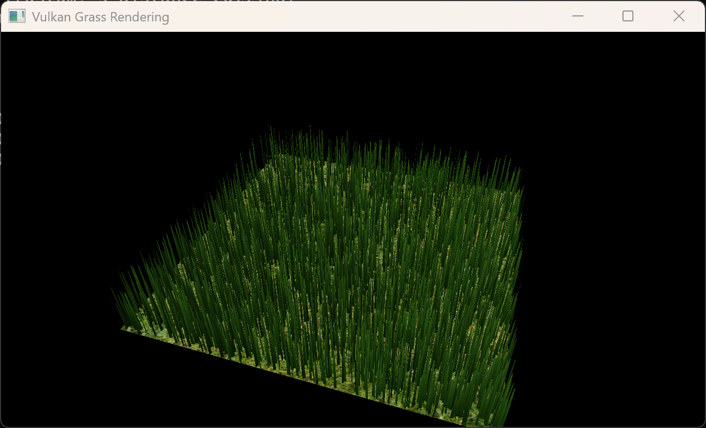
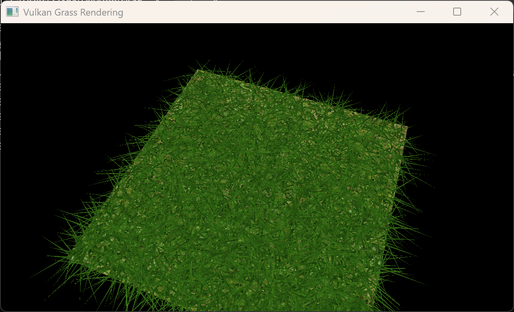
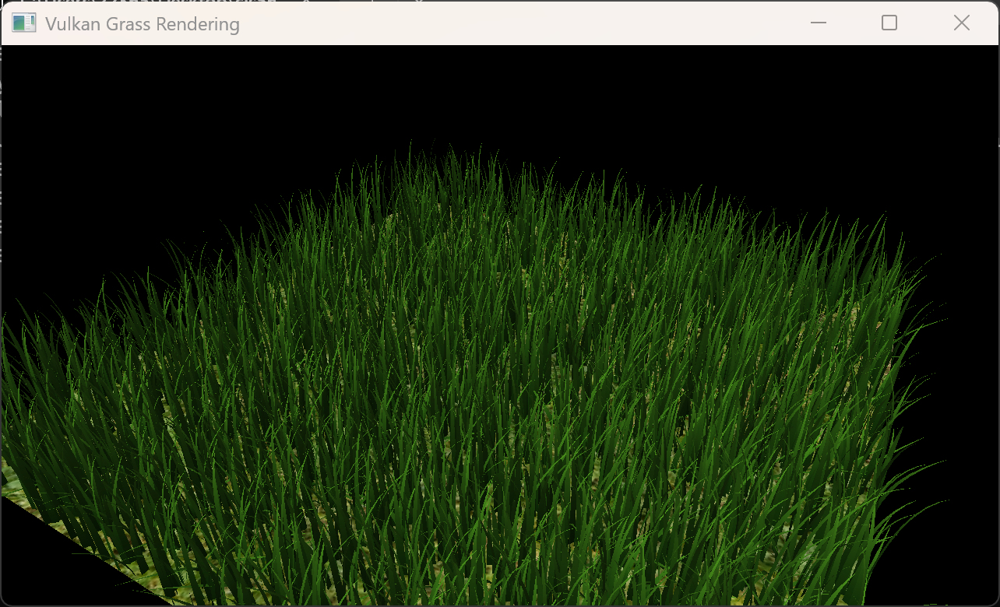
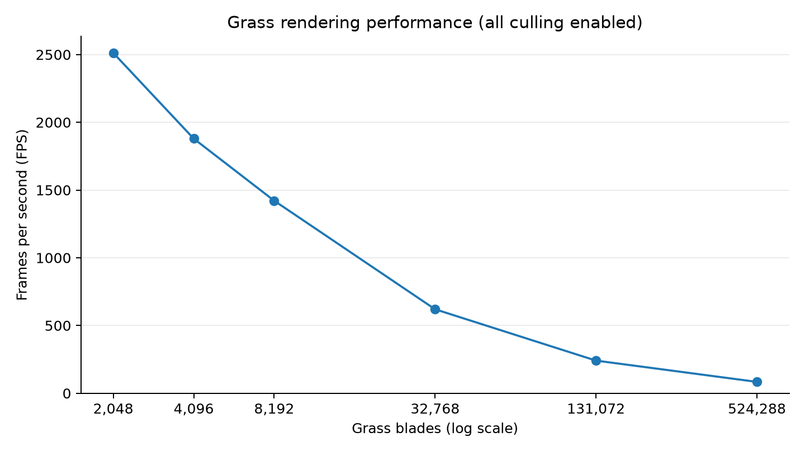
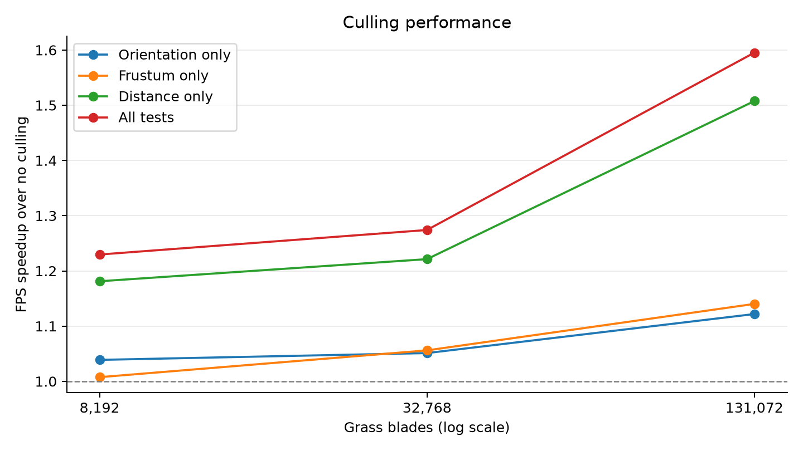

Vulkan Grass Rendering
==================================

**University of Pennsylvania, CIS 565: GPU Programming and Architecture, Project 5**

* Ziqiu Wang
* Tested on: Windows 11 Home, Intel Core Ultra 9 290HX Plus @ 2.7GHz 32GB, RTX 5080 16GB (Personal Computer)

## Project Overview

This project implements grass simulation and rendering in Vulkan, based on [Responsive Real-Time Grass Rendering for General 3D Scenes](https://www.cg.tuwien.ac.at/research/publications/2017/JAHRMANN-2017-RRTG/) by Jahrmann and Wimmer (2017). Grass blades are modeled as Bezier curves, animated by forces in a compute shader, and culled and tessellated.

(Note: you may notice some jittering or flickering in the videos in this project, and these were caused by screen recording. Neither occurs when running the application only; they are merely weird artifacts of screen recording using the Snipping Tool.)

## Project Details

### Grass Rendering and Tessellation

Each grass blade is a Bezier curve. Its control points, orientation, height, width, up vector, and stiffness are packed into four `vec4`s, with random blade properties and positions across the ground plane. The blades each enter the graphics pipeline as one tessellation patch. The tessellation evaluation shader uses De Casteljau's algorithm to calculate the blade geometry. 

### Force Simulations

At each frame, a compute shader updates every blade's tip using the combined forces multiplied by a fixed timestep:

- **Gravity:** combines downward environmental gravity with a smaller force along the blade's front direction to make the blade bend.
- **Recovery:** pulls the tip toward its initial upright position. The restoring force scales with displacement and blade stiffness, so stiffer blades resist bending more strongly.
- **Wind:** uses sine and cosine gusts that vary with position and time. Wind direction, wind strength, and wind alignment determine the force from the wind.

After applying the forces, the shader keeps tips on or above the local ground plane, adjusts `v1` according to the bend, and performs rescaling to roughly preserve the blade's length.

**No forces**

**Gravity**

**Gravity + Recovery**

**Gravity + Recovery + Wind**

### Culling Tests

Three culling tests are used to reduce the number of blades sent for tessellation:

- **Orientation culling:** compares the viewing direction with the blade's width direction and rejects nearly edge-on blades.
- **View-frustum culling:** projects the root, tip, and Bezier midpoint into clip space and rejects a blade when all three points lie outside the view frustum, with a tolerance value added.
- **Distance culling:** groups blades into buckets using the their distances from the camera. Farther buckets retain fewer blades, and blades beyond the maximum distance are simply discarded.

You may toggle the three tests with keys `1`, `2`, and `3` respectively.

These recordings use the same final scene with all three culling tests enabled. Each camera movement highlights a different culling feature.

**Orientation culling**

Notice how the blades near the right edge of the screen get culled when the view vector becomes almost parallel to the blades' width directions.

**View-frustum culling**

Notice how the blades nearer than the near-clip plane get culled. It is also easy to see the culling effect by toggling it on and off with the key `2`.

**Distance culling**

<video src="img/distance.mp4" controls width="800"></video>

## Performance Analysis

### Number of Grass Blades

| Number of grass blades | FPS |
| ---: | ---: |
| 2048 | 2512.036 |
| 4096 | 1879.262 |
| 8192 | 1421.150 |
| 32768 | 619.771 |
| 131072 | 240.904 |
| 524288 | 83.835 |

With a fixed camera showing most of the grass and all culling tests enabled, FPS decreases monotonically from 2512.036 at 2048 blades to 83.835 at 524288 blades, while average frame time rises from 0.398 ms to 11.928 ms. Therefore, increasing the blade count by a factor of 256 increases frame time only by about 30 times, so frame time grows more slowly than blade count rather than linearly. One likely reason is that costs such as command submission and presentation do not grow in proportion to blade count, so these costs are amortized over more blades as the blade count increases. Another possible reason is that larger workloads may also use the GPU's parallel capacity more efficiently.

### Culling Tests

| Culling configuration | FPS (8192 blades) | FPS (32768 blades) | FPS (131072 blades) |
| --- | ---: | ---: | ---: |
| All off | 1169.740 | 454.051 | 150.342 |
| Orientation only | 1215.168 | 477.280 | 168.661 |
| Frustum only | 1178.551 | 479.498 | 171.420 |
| Distance only | 1381.723 | 554.516 | 226.656 |
| All on | 1438.348 | 578.495 | 239.833 |

With a fixed camera, the graph compares each configuration against the all-off baseline (dashed line at 1.0) at the same blade count. Distance culling brings the largest individual FPS improvement: 18.1%, 22.1%, and 50.8% at 8192, 32768, and 131072 blades, respectively. Orientation culling improves FPS by 3.9% to 12.2%, while frustum culling improves it by 0.8% to 14.0% across these runs with different blade counts. The reason why distance culling gives the largest improvement is simply that it usually easily culls many more blades than the other two tests, resulting in less work. However, since the benefit of distance culling depends heavily on the actual distance between the camera and the blades, it may not be the most beneficial when the camera is very close to all the blades so that only a very small fraction of the blades gets culled by distance culling.

Enabling all three tests gives the best performance at every blade count, raising FPS by 23.0%, 27.4%, and 59.5%, respectively. Across all configurations, FPS decreases by a smaller factor than blade count increases. The possible reasons for this are exactly the same as those discussed in the blade count analysis above, as they are essentially the same problem. 

## References

- [Hash Function Prospector](https://github.com/skeeto/hash-prospector): `lowbias32` used in `hashBlade` in the compute shader `compute.comp`.
